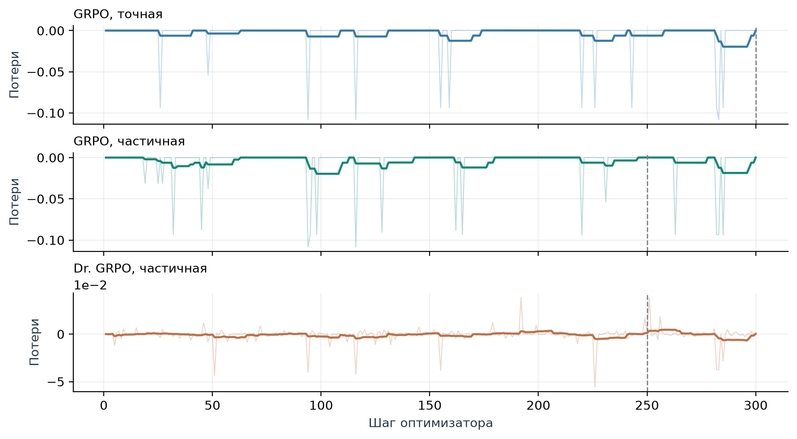
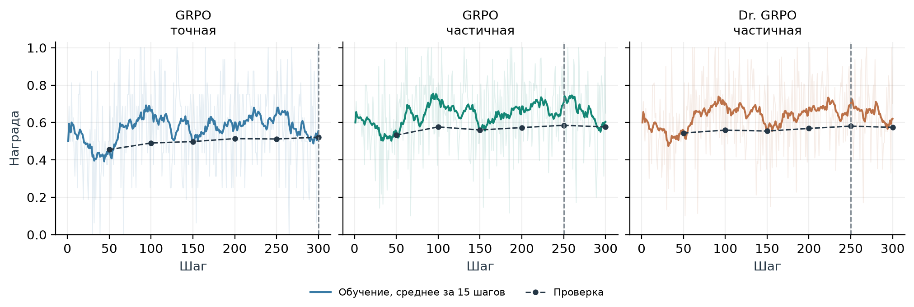
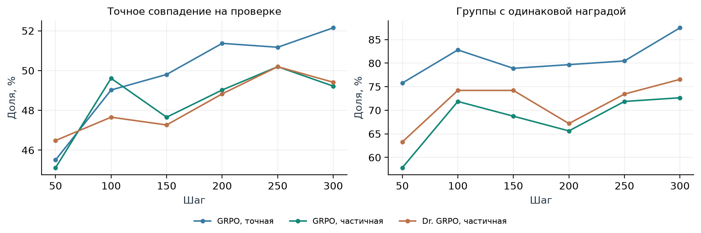

# ДЗ-5. Обучение модели вызову функций

Qwen3.5-2B дообучена на ToolACE через GRPO и Dr. GRPO с LoRA, без SFT. Все три запуска начинаются с исходной модели; перед BFCL адаптер объединяется с её весами. Общий сид модели и данных: 42.

## Результаты

Точность на 350 примерах BFCL, %. `overall` усредняет точность категорий внутри групп, затем пять групп. Это отличается от доли правильных ответов: у лучшей модели верны 271 из 350.

| Модель | overall | Один вызов | Выбор функции | Параллельно | Параллельный выбор | Без вызова |
| --- | ---: | ---: | ---: | ---: | ---: | ---: |
| Исходная | 68,93 | 66,00 | 78,67 | 56,00 | 80,00 | 64,00 |
| GRPO, точная награда | 73,87 | 74,00 | 79,33 | 54,00 | 84,00 | 78,00 |
| GRPO, частичная награда | **75,33** | **76,00** | **82,67** | **70,00** | 82,00 | 66,00 |
| Dr. GRPO, частичная награда | 73,73 | 72,00 | 80,67 | 62,00 | 80,00 | 74,00 |

## Данные

Использован только Team-ACE/ToolACE: 11 300 диалогов. `prepare.py` извлекает схемы инструментов из системного сообщения и разбирает эталоны через `ast.literal_eval`, без исполнения функций. Целями служат ответы ассистента после сообщений пользователя; результаты инструментов остаются в истории. Формат вызовов заменён шаблоном Qwen с `<tool_call>`, эталон исключён из запроса.

Разделение по хешу диалога выполнено до разворачивания, доля проверки 0,1. Части диалога остаются в одной выборке. Исключены 629 диалогов: 518 с другим форматом инструментов, 104 с некорректным синтаксисом, четыре с неподходящими именами функций и три повтора. Удалены пять обучающих запросов, совпавших с проверочными, и 11 запросов длиннее 3072 токенов.

| Показатель | Обучение | Проверка |
| --- | ---: | ---: |
| Примеры до ограничения длины | 10 647 | 1 149 |
| Примеры после ограничения длины | 10 636 | 1 149 |
| Без вызова | 2 073 (19,47%) | 217 (18,89%) |
| Без доступных инструментов | 221 | 27 |
| Длина запроса: медиана / 95-й процентиль / максимум | 689 / 1 391 / 4 598 | 688 / 1 396 / 2 705 |
| Длина эталона: медиана / 95-й процентиль / максимум | 68 / 282 / 1 241 | 64 / 264 / 1 136 |

Длины измерены в токенах; для эталонов оценка зависит от шаблона. Три эталона превышают лимит ответа 1024 токена. Для выбора шага использованы одни и те же 128 проверочных запросов. BFCL в подготовке и выборе шага не участвовал.

## Награда и обучение

`V` обозначает корректную разметку, `E` полное совпадение мультимножества вызовов, `N` F1 по именам, `C` F1 по вызовам с аргументами. Порядок вызовов не учитывается, повторы учитываются. Для `m` предсказаний, `n` эталонов и `k` совпадений: `F1 = 2k / (m + n)`.

```text
R_точная = V × E
R_частичная = V × (0,6 × E + 0,2 × N + 0,2 × C)
```

При пустом эталоне награда равна 1 только за допустимый непустой ответ без вызовов. Содержание текста не проверяется. Пустые, некорректные и обрезанные ответы получают 0.

| Ответ | Точная | Частичная |
| --- | ---: | ---: |
| Полное совпадение | 1 | 1 |
| Нужная функция, неверные аргументы | 0 | 0,2 |
| Один правильный вызов из двух | 0 | 0,2667 |
| Лишний вызов при пустом эталоне | 0 | 0 |

В сохранённых примерах три правильных вызова `Retrieve_Listings` получили 1. Вызов `market_undervalued_growth_stocks()` без требуемого `start=0.0` получил 0 и 0,2. Вариант `start=0` также штрафуется: буквальное сравнение JSON различает эквивалентные числа `0` и `0.0`.

| Запуск | Изменение и гипотеза | Выбранный шаг | Проверочная награда |
| --- | --- | ---: | ---: |
| `grpo_exact` | Полное совпадение как исходная постановка | 300 | 0,5215 |
| `grpo_shaped` | Только частичная награда: уменьшить разреженность сигнала | 250 | 0,5850 |
| `dr_grpo_shaped` | Убрать деление `A_i` на стандартное отклонение и нормировать потери на фиксированную длину; проверить совместный эффект | 250 | 0,5806 |

Общие настройки: 300 шагов, AdamW, скорость обучения 5×10⁻⁶, косинусное расписание, прогрев 30 шагов, ограничение нормы градиента 1. Микробатч 2, накопление 8, четыре ответа на запрос, одно обновление на генерациях. Температура 0,8, `top_p=0.95`, запрос до 3072 и ответ до 1024 токенов. Коэффициент KL 0,02, граница клиппинга 0,2; обрезанные ответы исключены из потерь.

LoRA: ранг 16, `alpha=32`, `dropout=0`, 16 819 200 параметров в проекциях внимания и MLP. Каждый запуск использовал одну H100 80 ГБ, BF16, SDPA, повторное вычисление активаций и генерацию Transformers. Проверка каждые 50 шагов: 128 запросов по четыре ответа, выбор по максимальной награде ToolACE.



Тонкие линии показывают шаги, толстые линии показывают среднее за 15 шагов. Пунктир отмечает выбранную точку. Масштабы потерь GRPO и Dr. GRPO различаются из-за нормировки.



Абсолютные значения разных функций награды несопоставимы. У GRPO с частичной наградой проверочная награда выросла с 0,5326 на шаге 50 до 0,5850 на шаге 250, затем снизилась до 0,5761.



Слева общая метрика точного совпадения ToolACE, справа доля групп с одинаковыми наградами.

## Ответы на вопросы

**1. Почему выбрана такая награда?** Полное совпадение проверяет весь набор вызовов, частичная награда различает частично правильные вызовы и сохраняет 60% веса за полным совпадением. Отдельное правило для пустого эталона поощряет отказ от ненужного вызова.

**2. Какое изменение сильнее повлияло на качество?** GRPO с частичной наградой прибавил 6,40 п.п. к исходной модели и 1,47 п.п. к точной награде. Во втором сравнении изменена только награда; данные, параметры и процедура выбора шага совпадают. Dr. GRPO уступил ему 1,60 п.п.; две изменённые нормировки по отдельности не проверялись.

**3. Совпадает ли рост награды с ростом BFCL?** Однозначного соответствия нет: точное совпадение ToolACE составляет 52,15% у точной награды и 50,20% у частичной, но BFCL выше у частичной. Она поощряет правильное имя при неверных аргументах. BFCL допускает некоторые альтернативные записи, которые отвергает буквальное сравнение ToolACE. BFCL измерен только на выбранных шагах, поэтому корреляция во времени не оценена.

**4. Что происходит при одинаковых наградах?** В GRPO `A_i = (R_i − mean(R)) / (std(R) + δ)`: все `A_i` равны нулю. В Dr. GRPO без деления на стандартное отклонение результат тот же. Основной член градиента политики не даёт сигнала, KL-член может давать градиент. На проверках такие группы составили 75,8-87,5% для точной награды и 57,8-72,7% для частичной.

**5. Какие ошибки остались?** У лучшей модели 79 ошибок против 99 у исходной; исправлены 24 ответа, испорчены четыре. Пропуски вызовов сократились с 33 до 14, ошибки аргументов с 37 до 35, неполные параллельные наборы выросли с пяти до семи.

| Категория и пример | Ошибка лучшей модели |
| --- | --- |
| Лишний вызов, `irrelevance_11` | На вопрос о ближайшем к 30 целом числе вызывает `get_closest_prime(number=30, skip=0)`. Нужен ответ без инструмента; исходная модель проходила проверку. |
| Пропущенный вызов, `simple_241` | Отвечает об Аврааме Линкольне текстом вместо `US_President_During_Event(event="Civil War", country=...)`. |
| Неверный аргумент, `live_multiple_460-145-11` | При поиске бесплатных парков Нью-Йорка для детей пропускает `category="Park"` у `Travel_1_FindAttractions`. |

## Воспроизведение

```bash
uv pip install --no-deps -r requirements.txt
```

В едином списке закреплены все зависимости, включая сборку отчёта. `--no-deps` позволяет установить использованные версии при несовместимом требовании NumPy в метаданных BFCL.

Подготовка данных и локального кэша модели:

```bash
set -euo pipefail
hf download Team-ACE/ToolACE data.json --repo-type dataset \
  --revision 6bda777c88d21e5a204703c1ee45597a8fa4f734 \
  --local-dir data/raw/toolace
python3 prepare.py --seed 42 --validation-fraction 0.1
export HW5_MODEL=/absolute/path/to/Qwen3.5-2B
source scripts/env.sh
python3 scripts/cache_model.py --model "$HW5_MODEL"
python3 analyze.py
python3 scripts/check_env.py
```

Каждый запуск начинает обучение с исходной модели. Лучшая точка загружается перед сохранением адаптера; оценка получает объединённые веса. Новые результаты записываются в `work/`:

```bash
python3 evaluate.py Qwen/Qwen3.5-2B --output work/results/base
for run in grpo_exact grpo_shaped dr_grpo_shaped; do
  python3 train.py "configs/$run.json" \
    --model "$HW5_MODEL" --output "work/runs/$run"
  python3 merge.py --model "$HW5_MODEL" \
    --adapter "work/runs/$run/adapter" --output "work/models/$run"
  python3 evaluate.py "./work/models/$run" --output "work/results/$run"
done
```

| Путь | Содержимое |
| --- | --- |
| `results/base/`, `results/{grpo_exact,grpo_shaped,dr_grpo_shaped}/` | `metrics.json` и `predictions.jsonl`, по 350 ответов |
| `configs/`, `runs/<имя>/` | Настройки, история, выбранные шаги, примеры награды, сведения об экспорте |
| `data/`, `figures/` | Манифест, статистика, графики |
| `data/model_assets.json` | Настройки и контрольные суммы исходного токенизатора; файлы берутся из локальной модели |

Проверка всех 1400 сохранённых предсказаний и сборка PDF, без GPU:

```bash
python3 report.py --check
python3 report.py
```
