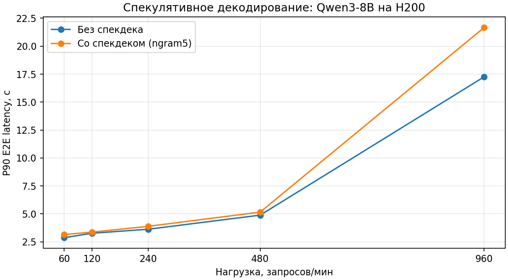
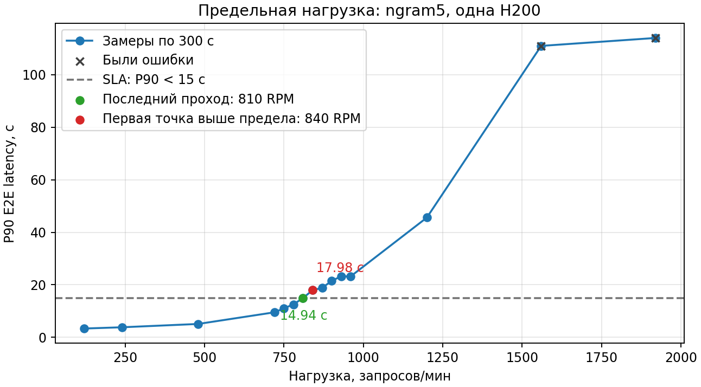

# ДЗ-6. Инференс Qwen3-8B в vLLM

Запускал vLLM 0.22.0 из окружения `hse`, по одной H200 на экземпляр. Модель работала в BF16. Прогоны шли параллельно на узле Slurm (задание `511627`).

Взял 640 запросов из файла задания `data/requests.jsonl`. Отключил рассуждения, выставил температуру 0, seed 42 и ограничил ответ 512 токенами.

AIPerf 0.13.0 не запустился без `ruamel.yaml`, поэтому мерил своим клиентом. Перед замером перезапускал сервер, чтобы очистить кэш, и прогревал его 40 запросами с параллелизмом 8. Клиент отправлял запросы через равные интервалы независимо от ответов. Таймер E2E запускал при отправке запроса, останавливал при получении последнего фрагмента текста. RPM обозначает число запросов в минуту. [Код клиента](bench.py).

## 1. Задержка при 120 RPM

Все конфигурации обработали 640 запросов без ошибок. Для `S` делил среднюю задержку базовой конфигурации на среднюю задержку текущей.

| Конфигурация | Mean, с | P90, с | S |
|---|---:|---:|---:|
| База (до 8192 токенов в батче и 1024 последовательностей) | 2,509 | 3,268 | 1,000 |
| До 4096 токенов в батче | 2,507 | 3,262 | 1,001 |
| До 2048 токенов в батче | 2,503 | 3,244 | 1,002 |
| До 64 последовательностей | 2,504 | 3,253 | 1,002 |
| До 4096 токенов в батче и 64 последовательностей | 2,493 | **3,241** | 1,006 |
| Eager, без CUDA-графов | 4,437 | 5,606 | 0,565 |
| N-gram, до 3 черновых токенов | 2,394 | 3,366 | 1,048 |
| **N-gram, до 5 черновых токенов** | **2,375** | 3,370 | **1,056** |

С `ngram5` средняя задержка снизилась на **5,3%**, а P90 вырос на **3,1%**. При других лимитах батчинга средняя отличалась от базовой менее чем на 1%. Eager оказался самым медленным. Каждый вариант прогнал один раз.

## 2. Спекулятивное декодирование



На каждой точке обе конфигурации получили те же 640 запросов. С `ngram5` P90 вырос на всех точках (с 2,869 до 3,149 с при 60 RPM и с 17,261 до 21,673 с при 960 RPM). Средняя задержка была ниже на проверенных точках до 480 RPM включительно, а при 960 RPM выросла с 10,687 до 12,680 с.

При 120 RPM сервер принял около 22% черновых токенов. Они экономят шаги генерации, а проверка черновиков требует вычислений. При включении n-gram vLLM автоматически перешёл с Model Runner V2 на V1. Замер включает эффект этого переключения.

## 3. Предел нагрузки



На каждой точке клиент 300 секунд подавал запросы по кругу, затем ждал, пока они завершатся. Засчитывал точку, если P90 ответа < 15 с, P90 отставания от расписания < 0,1 с и все запросы прошли. [Скрипт нагрузки](load_test.sh).

| Нагрузка | P90, с | Успешные запросы | SLA |
|---:|---:|---:|---|
| 780 RPM (13 запросов/с) | 12,565 | 3900 / 3900 | Выполнен |
| **810 RPM (13,5 запроса/с)** | **14,944** | **4050 / 4050** | **Выполнен** |
| 840 RPM (14 запросов/с) | 17,981 | 4200 / 4200 | Превышен порог P90 |

Максимум в пределах SLA составил **810 RPM** с запасом 56 мс. Около границы проверял нагрузку с шагом 30 RPM. На 1560 и 1920 RPM были таймауты, поэтому P90 считал по успешным ответам.

[Результаты 31 замера в CSV](results/measurements.csv).

## Запуск

```bash
run_dir="runs/$(date -u +%Y%m%dT%H%M%SZ)"
srun -p main -N 1 -n 1 -c 224 --mem=0 --gres=gpu:h200:8 --exclusive \
  --time=01:00:00 python -u -B run.py "$run_dir"
python -B plot.py "$run_dir"
```
